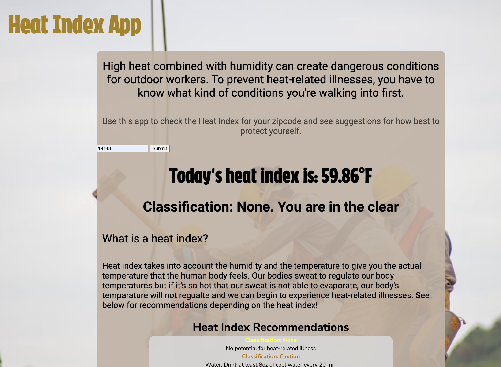

# 🏗️ Project: Simple API 1 - Construction

### Goal: Build a simple front-end app that displays data returned from an api that would be beneficial to someone in the trades (construction, hvac, plumbing, ect)

### My project: I created a Heat Index Recommendations App. 
This app is designed to give the heat index of the zipcode location that user chooses. The National Weather Service in the US shares "The heat index, also known as the apparent temperature, is what the temperature feels like to the human body when relative humidity is combined with the air temperature."

Our bodies sweat to regulate themselves or reach 'homeostasis' by cooling down. If the weather outside is so hot AND humid that our sweat isn't able to evaporate, our bodies can overheat and fall victim to heat-related injuries.

There are many resources for employers to use to ensure the safety of outdoor workers. Consider the following resources:
- [National Weather Service](https://www.weather.gov/ama/heatindex)
- [Occupational Safety and Health Administration (OSHA)](https://www.osha.gov/heat-exposure)
- [Safe at Work California: An Employer's Guide [video]](https://www.safeatworkca.com/videos/heat-illness-prevention-an-employers-guide/)
- [ERA-Environmental Blog Post: Health and Safety Planning Under OSHA's Heat Illness Regulations 2024](https://www.era-environmental.com/blog/osha-heat-illness-health-and-safety)

### Features:
- Use the search bar to input a zip code and recieve heat index information as well as recommendation.
 User can input a zip code to check the heat index of that area
- User will also see the 'Classification' that is awarded depending on the heat index. 
- User can view recommendations in the chart at the bottom

### How to Access:
- Use the link in the about section of this repo or simply, [CLICK HERE](https://priscilla-ruilova.github.io/Heat-Index-App/).